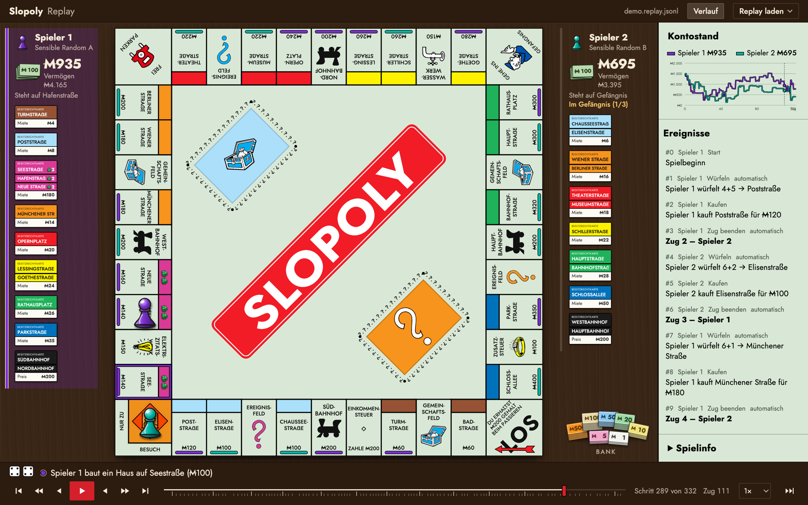

# Slopoly

RL and LLM agents mastering the game of Monopoly (German edition, simplified rules), plus **Slopoly**, a replay viewer for watching games.

| Folder | What |
|---|---|
| [`engine/`](engine/README.md) | Python/NumPy game engine, random play, replay export |
| [`viewer/`](viewer/README.md) | Replay viewer (Vite + React + TS), builds to a single `index.html` |
| [`docs/game_state.md`](docs/game_state.md) | Contract: state layout, actions, events, replay format |
| `replays/` | Sample replays (`*.replay.jsonl`) and training logs (`*.games.jsonl`) |

Contributing: [CONTRIBUTING.md](CONTRIBUTING.md) · AI agents: [AGENTS.md](AGENTS.md)

Board icons derived from [Monopoly Kit](https://www.figma.com/community/file/1369415023799516229/monopoly-kit) by Cammy Hogg, CC BY 4.0.
